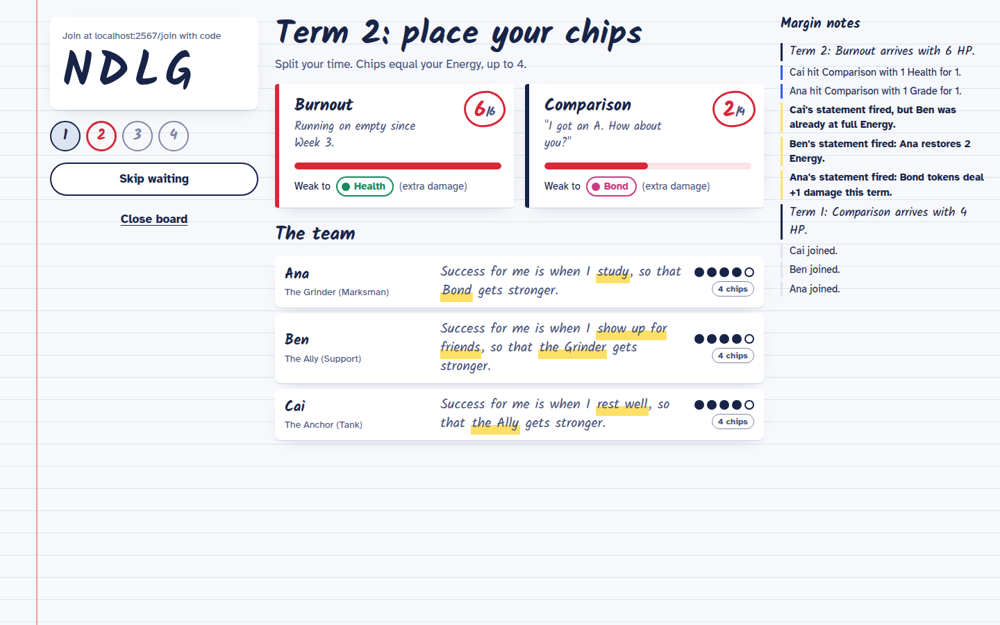
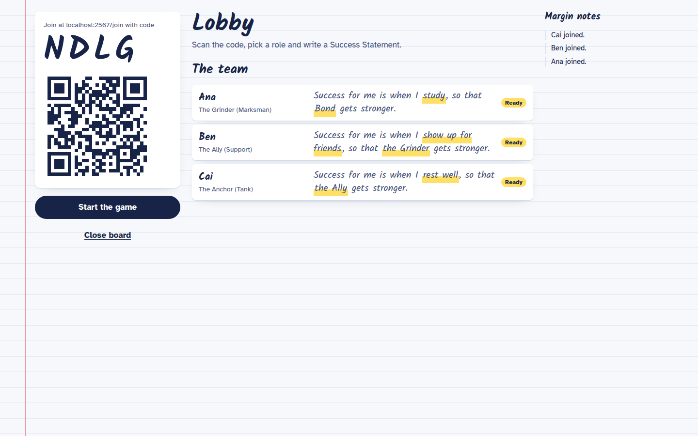
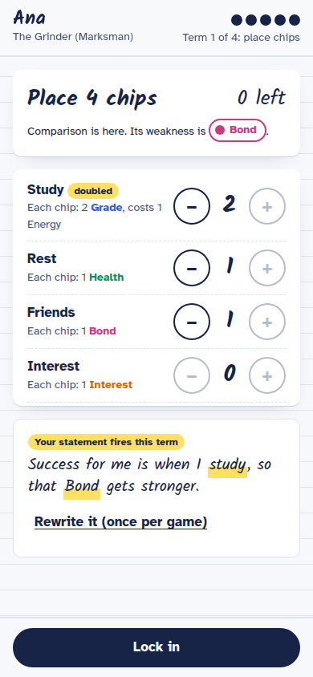
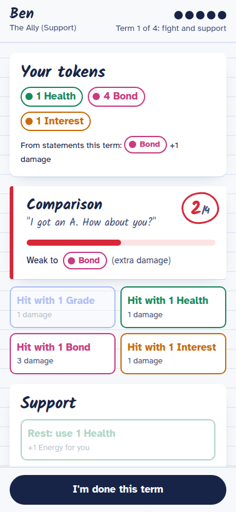

# No Solo Carry

A cooperative game about redefining success. A class plays in groups of 3 to 5, one phone per player, with a shared board screen on the projector. The team beats four bosses (Comparison, Burnout, Fear of Failure and Results Day) or loses together. Grades alone can't win it.

Built as the prototype for an NTU CC0015 (Healthy Living and Wellbeing) group project on students who treat their grades as a measure of their self-worth.



| Board screen lobby | Placing chips | Fight and support |
| --- | --- | --- |
|  |  |  |

## How the game works

- **Roles.** Each player picks one of five roles, named after MOBA roles. Each role doubles one activity: the Grinder (Study), Anchor (Rest), Ally (Friends), Spark (Interest) or Explorer (any one, chosen each term).
- **Success Statement.** Each player writes *"Success for me is when I [action], so that [target] gets stronger."* The target must be a teammate's role (restores 2 of their Energy) or a token type (+1 damage for the whole team). It can never be yourself. It fires in any term you put 2+ chips on its action, and can be rewritten once per game.
- **Each term:**
  1. Reveal the boss.
  2. Place Time chips. You get one chip per point of Energy, up to 4. Each Study chip costs 1 Energy.
  3. Statements fire.
  4. Fight and support: tokens deal damage, or restore Energy (Health for yourself, Bond for a teammate).
  5. End of term: everyone loses 1 Energy, and unspent tokens are discarded.
- **Results Day** only takes full sets: one Grade, Health, Bond and Interest token together.
- The team wins if every boss is beaten by the end of Term 4. There are no individual scores.

## Run it locally

Requires Node 20 or newer.

```bash
npm install
npm run dev
```

Open http://localhost:5173 and choose **Open a board screen**. Phones on the same Wi-Fi can join at `http://<your-laptop-ip>:5173/join/<CODE>`, or by scanning the QR code on the board.

To run the production build the same way Render does:

```bash
npm run build
npm start          # http://localhost:2567
```

## Deploy to Render (free)

1. Push this repository to GitHub.
2. In the Render dashboard, choose **New > Blueprint** and select the repository. Render reads `render.yaml`, which sets up one free web service in the Singapore region. That service serves both the page and the WebSocket server.
3. When it's live, open the `.onrender.com` URL on the projector and choose **Open a board screen**.

The free tier spins a service down after 15 minutes without traffic ([Render changelog](https://render.com/changelog/free-web-services-now-remain-active-while-receiving-websocket-messages)), and the first request then takes a while to wake it. **Open the link a few minutes before you present.** Games live in memory, so a restart or spin-down ends any game in progress.

## Tuning the balance

Every number lives in [`packages/shared/src/config.ts`](packages/shared/src/config.ts): boss HP, Energy costs, chips per term, statement effects, and HP multipliers per group size.

The simulator plays thousands of games through the real rules engine with scripted strategies:

```bash
npm run sim                                 # 5 players, 2000 games per strategy
npm run sim -- --players 3 --games 500
npm run sweep --workspace=@nsc/sim          # win rates across a range of boss HP
```

Results with the current numbers (1,000 games per strategy):

| Strategy | 5 players | 4 players | 3 players |
| --- | --- | --- | --- |
| Balanced, supports tired teammates | 100% | 100% | 100% |
| Same team, never spends tokens on Energy | 0% | 0% | 0% |
| Every chip on Study | 0% | 0% | 0% |
| Random chips | 5% | <1% | 31% |

The numbers were set at the easiest difficulty where skipping support still loses, to leave room for human mistakes. At 4 players, teams whose statements target teammates win and teams whose statements only target token types lose.

The bots are heuristics, not optimal players, so treat these as relative comparisons and confirm with real playtests.

## Project structure

```
packages/
  shared/   Rules engine: pure (state, action) -> new state functions, config, types, unit tests
  server/   Colyseus room per group, 4-letter join codes, reconnection; serves the built client
  client/   React app: board screen (projector) and phone view
  sim/      Balance simulator and tuning sweep
```

The server owns the game state. A phone sends an intent (for example `place` or `attack`), the room applies the matching rules-engine function, and the full new state is broadcast to everyone. The same engine runs in the tests and the simulator, so they test the exact rules the server enforces.

Connections handle real classrooms:
- A phone that drops (screen locked, Wi-Fi blip) keeps its seat for 5 minutes and reconnects automatically.
- A refreshed page resumes where it was.
- Rejoining with the same name takes back a seat, so a player can switch to a new phone.
- The board screen can reclaim host control after a refresh.
- There are no accounts: players join with a code and a nickname, and nothing is stored after the game.

## Testing

```bash
npm test                                   # rules engine unit tests
npm run typecheck
npm run smoke --workspace=@nsc/server      # full game over WebSockets against a running server
```

CI (`.github/workflows/ci.yml`) runs the typecheck, tests, a short simulation and the build on every push.

## Background

The design comes from the group's persona research. Two sources shaped the core mechanics:

- Academic expectations stress, from both self and parents or teachers, is associated with severe depression and anxiety among Singapore youth ([Chua et al., 2026](https://doi.org/10.3389/fpsyg.2026.1785980)).
- Students given a self-transcendent purpose for learning persisted longer on tedious work ([Yeager et al., 2014](https://web.stanford.edu/~paunesku/articles/yeager_2014.pdf)). This is the basis for statements that must help someone else.

Building your own statement from parts was inspired by *Rules Race* in *The Devil's Plan*.

Built with [Colyseus](https://colyseus.io/), React and Vite.
